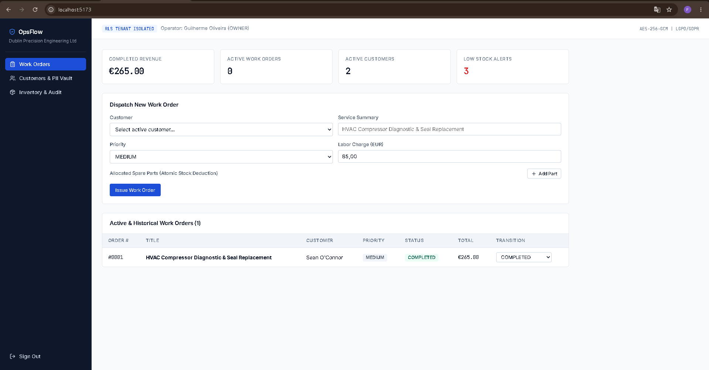
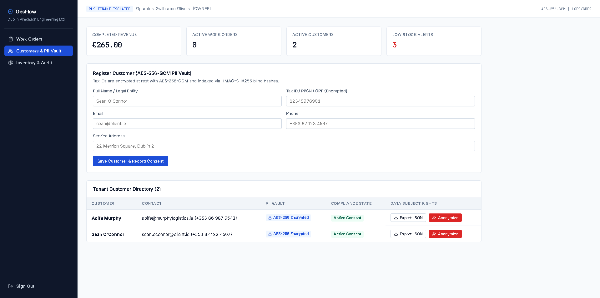
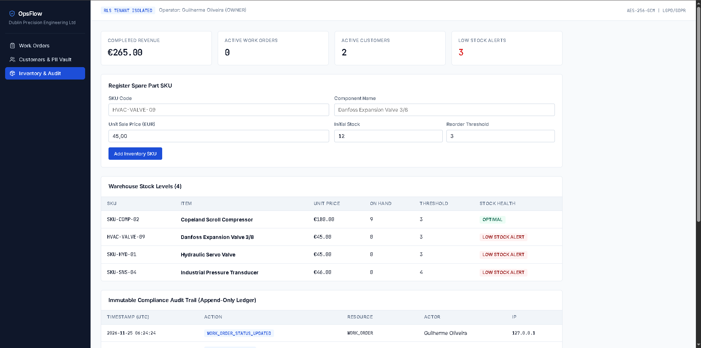

# OpsFlow

**Multi-tenant field operations console with privacy-oriented workflows**

OpsFlow is a full-stack portfolio project for technical service and field-maintenance teams. It combines a React/Vite console, a Fastify API, and PostgreSQL to demonstrate tenant-scoped operations, inventory and work-order workflows, encrypted customer document storage, consent records, data export, anonymisation, and audit logging.

This repository is a demonstrable software project, not a claim of legal compliance, production readiness, or security certification. The privacy features are application capabilities that can support data-subject workflows; legal obligations depend on the organisation, processing context, policies, and operational controls around the software.

## Architecture

- **Web console:** React 18, TypeScript, Vite, and a custom design system.
- **API:** Node.js, TypeScript strict mode, Fastify 5, Zod, JWT, Pino, and Argon2id password hashing.
- **Database:** PostgreSQL 16 with tenant-scoped tables, Row-Level Security (RLS), and a trigger protecting audit-log rows from update/delete.
- **API documentation:** OpenAPI 3.0.3 generated from Fastify route schemas derived from the Zod request schemas, with Swagger UI.
- **Deployment target:** two Vercel projects (`apps/web` and `apps/api`) backed by one empty Supabase PostgreSQL project.

The frontend and API are intentionally separate Vercel projects. This keeps the static Vite build independent from the Fastify function, gives each project a simple root directory and environment configuration, and avoids exposing database variables to the browser.

## Implemented capabilities

### Tenant-scoped data access

The migrations enable RLS on `organizations`, `users`, `customers`, `inventory_items`, `work_orders`, `work_order_items`, `stock_movements`, `consent_records`, and `audit_logs`. The API sets `app.current_tenant_id` locally inside tenant transactions, and the policies compare that setting with each row's `organization_id` (or the organisation `id`).

The migrations enable RLS; they do not use PostgreSQL `FORCE ROW LEVEL SECURITY`. The integration suite includes a cross-tenant customer-visibility scenario in [tenantIsolation.test.ts](apps/api/tests/integration/tenantIsolation.test.ts).

### Customer document protection

Customer documents are encrypted before persistence with AES-256-GCM using a 32-byte key from `PII_ENCRYPTION_KEY`. A keyed HMAC-SHA256 blind index supports tenant-local duplicate checks without storing the normalised document value in plaintext. This is an implementation detail of this project and should be reviewed before any real deployment.

### Privacy-support workflows

The API records consent events, exports a customer's structured data bundle for authorised OWNER and ADMIN users, records the export in `audit_logs`, and anonymises customer identifiers while retaining related operational records. These are privacy and data-subject workflow features; the project does not make a legal GDPR or LGPD compliance promise.

### Work orders and inventory

Monetary values are represented as integer cents. Work-order creation uses a database transaction and locks inventory rows while validating and deducting parts. Status validation is implemented in the API service layer. The migrations do not include database triggers for work-order status transitions.

## OpenAPI and Swagger UI

When the API is running locally:

- Swagger UI: `http://localhost:3333/docs/`
- OpenAPI JSON: `http://localhost:3333/openapi.json`
- Health check: `http://localhost:3333/health`

The documentation is public, but protected operations still use the same authentication and authorisation hooks as normal requests. The generated specification includes the full `/api/v1` paths, request bodies derived from Zod schemas, parameters, response envelopes, common error responses, tags, and a Bearer/JWT security scheme. Examples are fictional.

## Local setup

Prerequisites: Node.js 22+, npm, and Docker Desktop.

1. Start PostgreSQL:

   ```powershell
   docker compose up -d postgres
   ```

   On a new Docker volume, Compose runs the SQL files mounted from `apps/api/src/database/migrations/`. The database role and credentials in `docker-compose.yml` are local development values only.

2. Create the API environment file:

   ```powershell
   Copy-Item apps/api/.env.example apps/api/.env
   ```

   Create the frontend environment file if you want to override the local Vite proxy:

   ```powershell
   Copy-Item apps/web/.env.example apps/web/.env
   ```

   The example files contain fictional local-only values. Replace `JWT_SECRET` with a randomly generated secret of at least 32 characters and generate a fresh 32-byte hexadecimal `PII_ENCRYPTION_KEY`, for example:

   ```powershell
   node -e "console.log(require('node:crypto').randomBytes(32).toString('hex'))"
   ```

   Never commit `.env` or real credentials. `DATABASE_ADMIN_URL` is used only by migration/test tooling and must not be configured in the public API deployment.

3. Install dependencies:

   ```powershell
   npm install
   ```

4. For a separately provisioned database, run the migration script from the API workspace with the administrative connection configured in `DATABASE_ADMIN_URL`:

   ```powershell
   npm --workspace=apps/api run db:migrate
   ```

   The script loads `apps/api/.env` and applies the SQL files in order. The SQL files are initialisation scripts, not an idempotent migration framework. Apply them once to an empty database; do not rerun them against a database containing these objects without a safe migration plan.

5. Start the API and web console in separate terminals:

   ```powershell
   npm run dev:api
   npm run dev:web
   ```

   The local API listens on `http://localhost:3333` and the web console on `http://localhost:5173`. With an empty `VITE_API_URL`, Vite proxies `/api` to the local API.

## API overview

All business routes include the `/api/v1` prefix. The paths are registered in [app.ts](apps/api/src/app.ts) and the individual route modules.

| Method | Endpoint | Access | Description |
| :--- | :--- | :--- | :--- |
| POST | `/api/v1/auth/register` | Public | Creates an organisation, owner account, and initial consent record |
| POST | `/api/v1/auth/login` | Public | Authenticates an operator and issues a tenant-scoped JWT |
| GET | `/api/v1/auth/me` | Authenticated | Returns the current JWT subject |
| GET, POST | `/api/v1/customers` | Authenticated / OWNER, ADMIN, TECHNICIAN for POST | Lists or creates customers |
| PATCH | `/api/v1/customers/:id` | OWNER, ADMIN | Updates a customer |
| GET, POST | `/api/v1/inventory` | Authenticated / OWNER, ADMIN for POST | Lists or creates inventory items |
| POST | `/api/v1/inventory/:id/movements` | OWNER, ADMIN, TECHNICIAN | Records a stock movement |
| GET, POST | `/api/v1/work-orders` | Authenticated / OWNER, ADMIN, TECHNICIAN for POST | Lists or creates work orders |
| PATCH | `/api/v1/work-orders/:id/status` | OWNER, ADMIN, TECHNICIAN | Updates work-order status through API validation |
| GET | `/api/v1/privacy/customers/:id/export` | OWNER, ADMIN | Exports a customer's data bundle |
| POST | `/api/v1/privacy/customers/:id/anonymize` | OWNER, ADMIN | Anonymises customer identifiers |
| GET | `/api/v1/privacy/audit-logs` | OWNER, ADMIN | Lists tenant audit-log entries |

## Supabase deployment

Create or select an empty Supabase project in a European region. Do not copy the local Docker database or its data. The free plan is suitable for a small portfolio demonstration if it remains within the current free-plan limits; check the dashboard before enabling anything billable.

1. In the Supabase SQL Editor, enable the required extensions and apply the application SQL files once and in order:

   - `CREATE EXTENSION IF NOT EXISTS "uuid-ossp";`
   - `CREATE EXTENSION IF NOT EXISTS "pgcrypto";`
   - `apps/api/src/database/migrations/001_init_schema.sql`
   - `apps/api/src/database/migrations/002_rls_policies.sql`
   - `apps/api/src/database/migrations/003_lgpd_audit.sql`
   - `apps/api/src/database/migrations/004_auth_functions.sql`

   Do not run `docker/postgres/init.sql` unchanged in Supabase: it is local Docker bootstrap code and contains local-only role/database values. The RLS migration is written so it can run before the custom runtime role exists. For Supabase, create a non-superuser login role named `opsflow_app` using a strong password generated locally, then grant it only `CONNECT`, schema usage, the listed table/sequence privileges, and execution of the three authentication functions. Do not use the Supabase `postgres` owner credential in Vercel.

   Run the following only after replacing `<GENERATED_ROLE_PASSWORD>` locally and only in the Supabase SQL Editor; never commit the resulting password:

   ```sql
   CREATE ROLE opsflow_app LOGIN PASSWORD '<GENERATED_ROLE_PASSWORD>';
   GRANT CONNECT ON DATABASE postgres TO opsflow_app;
   GRANT USAGE ON SCHEMA public TO opsflow_app;
   GRANT SELECT, INSERT, UPDATE, DELETE ON ALL TABLES IN SCHEMA public TO opsflow_app;
   GRANT USAGE, SELECT ON ALL SEQUENCES IN SCHEMA public TO opsflow_app;
   GRANT EXECUTE ON FUNCTION register_organization_and_owner(TEXT, TEXT, TEXT, TEXT, TEXT, TEXT, INET, TEXT) TO opsflow_app;
   GRANT EXECUTE ON FUNCTION find_user_for_login(TEXT) TO opsflow_app;
   GRANT EXECUTE ON FUNCTION record_user_login(UUID, UUID, INET, TEXT) TO opsflow_app;
   ```

   Use the Supabase shared transaction pooler connection string on port `6543` for `DATABASE_URL`, with the custom role username format shown by Supabase's Connect dialog. The API keeps a pool of one connection per warm Vercel instance, uses SSL in production, and sets tenant state inside the same transaction as each tenant-scoped operation.

2. Configure the API project variables in Vercel. Set these names only; never expose them through `VITE_*` variables:

   - `NODE_ENV=production`
   - `PORT` (Vercel supplies the listener; the schema default is acceptable)
   - `DATABASE_URL` (Supabase transaction-pooler URL for `opsflow_app`)
   - `JWT_SECRET`
   - `PII_ENCRYPTION_KEY`
   - `CORS_ORIGIN` (the exact Vercel frontend origin; comma-separated values are supported for a controlled preview/local setup)

   Do not set `DATABASE_ADMIN_URL` on Vercel. The public API no longer uses administrative access for authentication; migration and local test cleanup are separate concerns.

## Vercel deployment

Use two Vercel projects connected to this GitHub repository:

### API project

- Root Directory: `apps/api`
- Framework: Fastify, or automatic detection
- Build command: `npm run build` (the current API build passes TypeScript compilation)
- Environment variables: the API variables listed above
- After deployment, verify `<api-project>.vercel.app/health`, `/docs/`, and `/openapi.json`

Vercel detects Fastify from `apps/api/src/server.ts` and runs the app as one Function. Database pools are created at module scope with a small per-instance limit. The current API uses Node APIs such as `pg`, `argon2`, and `crypto`, so it must stay on the Node.js runtime rather than Edge.

### Web project

- Root Directory: `apps/web`
- Framework preset: Vite
- Build command: `npm run build`
- Output directory: `dist`
- `VITE_API_URL`: the API project's Vercel origin, without a trailing slash

The browser never receives database or JWT-signing secrets. It sends requests to `${VITE_API_URL}/api/v1`; local development leaves this variable empty and uses the Vite proxy.

Deploy a preview first. Test the preview API and frontend with synthetic data, then promote to production only after checking CORS, registration, login, customer creation, OpenAPI routes, and tenant isolation.

## Checks

Available commands:

```powershell
npm run lint
npm run build
npm test --workspace=@opsflow/api
```

Integration tests require a separate configured test database. The migrations should be applied only once to an empty database. Do not use production Supabase data for tests.

## Screenshots

These screenshots are present in `docs/screenshots/`:





## Portfolio notes

- **Demo:** Add the deployed Vercel frontend URL here after the first verified production deployment.
- **Professional contact:** Add your preferred LinkedIn, GitHub, email, or portfolio URL before sharing this repository.
- **Contribution:** This project is presented as a full-stack implementation covering the React console, Fastify API, PostgreSQL schema and RLS policies, encrypted document handling, privacy-support endpoints, OpenAPI/Swagger documentation, and deployment configuration. Adjust this statement if the repository includes work from other contributors.

## Costs and limits

The intended portfolio setup uses the free tiers of Supabase and Vercel, subject to their current terms, quotas, inactivity pauses, function limits, database size, connection limits, and acceptable-use policies. Vercel's Hobby plan is intended for personal, non-commercial use. No paid plan, custom domain, add-on, or billing-enabled resource is required by this repository.

## Author

**Guilherme Oliveira** - Full Stack Software Engineer

Focused on multi-tenant SaaS architecture, applied cryptography, and privacy-oriented data workflows.
